<p align="center"><strong>English</strong> &nbsp; | &nbsp; <a href="README.fa.md">فارسی</a></p>

<picture>
  <source media="(prefers-color-scheme: dark) and (max-width: 600px)" srcset="docs/readme/hero-dark-mobile.webp">
  <source media="(max-width: 600px)" srcset="docs/readme/hero-light-mobile.webp">
  <source media="(prefers-color-scheme: dark)" srcset="docs/readme/hero-dark.webp">
  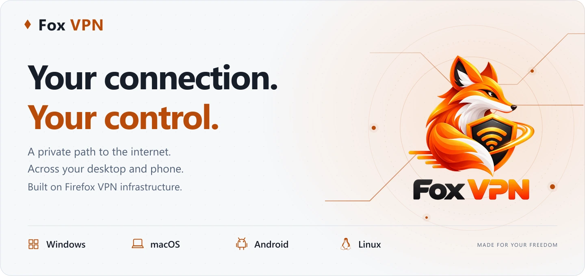
</picture>

<p align="center">
  
  
  
  
  
</p>

<p align="center">
  <a href="#download"><strong>Download v1.0.0</strong></a> &nbsp; · &nbsp;
  <a href="#the-workspace">Explore the app</a> &nbsp; · &nbsp;
  <a href="#get-connected">Get connected</a> &nbsp; · &nbsp;
  <a href="#support-the-project">Support the project</a>
</p>

**A familiar workspace for a more private connection.** Fox VPN brings system VPN, app-based routing and connection controls to your desktop and phone, with an English interface and light, dark and system appearance.

Sign in with a Firefox account to get started. Service eligibility, availability and data allowances apply. Fox VPN is an independent client and is not affiliated with Mozilla.

<a name="download"></a>

## 📥 Download

**v1.0.0** · [Release notes & all files](https://github.com/erfan-tahvilian/FoxVPN/releases/tag/v1.0.0) · [SHA-256 checksums](https://github.com/erfan-tahvilian/FoxVPN/releases/download/v1.0.0/SHA256SUMS.txt)

Choose the package that matches your operating system and processor. Installers and portable archives are available for desktop; Android packages are signed APKs.

<p align="center">
  <a href="https://github.com/erfan-tahvilian/FoxVPN/releases/download/v1.0.0/FoxVPN-1.0.0-Windows-x64.exe"><picture><source media="(prefers-color-scheme: dark)" srcset="docs/readme/download-windows-dark.svg">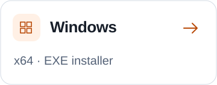</picture></a> &nbsp;&nbsp;&nbsp;
  <a href="https://github.com/erfan-tahvilian/FoxVPN/releases/download/v1.0.0/FoxVPN-1.0.0-macOS-arm64.dmg"><picture><source media="(prefers-color-scheme: dark)" srcset="docs/readme/download-macos-dark.svg">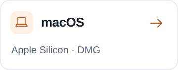</picture></a>
</p>
<p align="center">
  <a href="https://github.com/erfan-tahvilian/FoxVPN/releases/download/v1.0.0/FoxVPN-1.0.0-Linux-x64.AppImage"><picture><source media="(prefers-color-scheme: dark)" srcset="docs/readme/download-linux-dark.svg">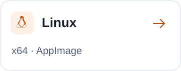</picture></a> &nbsp;&nbsp;&nbsp;
  <a href="https://github.com/erfan-tahvilian/FoxVPN/releases/download/v1.0.0/FoxVPN-1.0.0-Android-arm64-v8a.apk"><picture><source media="(prefers-color-scheme: dark)" srcset="docs/readme/download-android-dark.svg">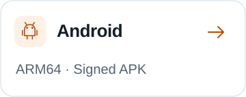</picture></a>
</p>

Quick downloads for common devices. **Every supported architecture is listed below.**

<!-- foxvpn-downloads:start -->

| Platform | Processor | Packages | Best fit |
| :--- | :---: | :--- | :--- |
| **Windows**<br><sub>Windows 10+</sub> | **x64** | [](https://github.com/erfan-tahvilian/FoxVPN/releases/download/v1.0.0/FoxVPN-1.0.0-Windows-x64.exe) &nbsp; [](https://github.com/erfan-tahvilian/FoxVPN/releases/download/v1.0.0/FoxVPN-1.0.0-Windows-x64.zip) | Most Intel / AMD PCs |
|  | **x86** | [](https://github.com/erfan-tahvilian/FoxVPN/releases/download/v1.0.0/FoxVPN-1.0.0-Windows-x86.exe) &nbsp; [](https://github.com/erfan-tahvilian/FoxVPN/releases/download/v1.0.0/FoxVPN-1.0.0-Windows-x86.zip) | 32-bit Windows PCs |
|  | **ARM64** | [](https://github.com/erfan-tahvilian/FoxVPN/releases/download/v1.0.0/FoxVPN-1.0.0-Windows-arm64.exe) &nbsp; [](https://github.com/erfan-tahvilian/FoxVPN/releases/download/v1.0.0/FoxVPN-1.0.0-Windows-arm64.zip) | Windows 11 on ARM |
| **macOS**<br><sub>macOS 13+</sub> | **Apple Silicon** | [](https://github.com/erfan-tahvilian/FoxVPN/releases/download/v1.0.0/FoxVPN-1.0.0-macOS-arm64.dmg) &nbsp; [](https://github.com/erfan-tahvilian/FoxVPN/releases/download/v1.0.0/FoxVPN-1.0.0-macOS-arm64.zip) | M-series Macs |
|  | **Intel x64** | [](https://github.com/erfan-tahvilian/FoxVPN/releases/download/v1.0.0/FoxVPN-1.0.0-macOS-x64.dmg) &nbsp; [](https://github.com/erfan-tahvilian/FoxVPN/releases/download/v1.0.0/FoxVPN-1.0.0-macOS-x64.zip) | Intel-based Macs |
| **Linux**<br><sub>64-bit desktop</sub> | **x64** | [](https://github.com/erfan-tahvilian/FoxVPN/releases/download/v1.0.0/FoxVPN-1.0.0-Linux-x64.AppImage) &nbsp; [](https://github.com/erfan-tahvilian/FoxVPN/releases/download/v1.0.0/FoxVPN-1.0.0-Linux-x64.deb) &nbsp; [](https://github.com/erfan-tahvilian/FoxVPN/releases/download/v1.0.0/FoxVPN-1.0.0-Linux-x64.rpm) | Intel / AMD Linux desktops |
|  | **ARM64** | [](https://github.com/erfan-tahvilian/FoxVPN/releases/download/v1.0.0/FoxVPN-1.0.0-Linux-arm64.AppImage) &nbsp; [](https://github.com/erfan-tahvilian/FoxVPN/releases/download/v1.0.0/FoxVPN-1.0.0-Linux-arm64.deb) &nbsp; [](https://github.com/erfan-tahvilian/FoxVPN/releases/download/v1.0.0/FoxVPN-1.0.0-Linux-arm64.rpm) | 64-bit ARM Linux desktops |
| **Android**<br><sub>Android 8+</sub> | **ARM64** | [](https://github.com/erfan-tahvilian/FoxVPN/releases/download/v1.0.0/FoxVPN-1.0.0-Android-arm64-v8a.apk) | Most current Android phones |
|  | **Universal** | [](https://github.com/erfan-tahvilian/FoxVPN/releases/download/v1.0.0/FoxVPN-1.0.0-Android-universal.apk) | All supported architectures; larger file |
|  | **ARMv7** | [](https://github.com/erfan-tahvilian/FoxVPN/releases/download/v1.0.0/FoxVPN-1.0.0-Android-armeabi-v7a.apk) | 32-bit ARM devices |
|  | **x86_64** | [](https://github.com/erfan-tahvilian/FoxVPN/releases/download/v1.0.0/FoxVPN-1.0.0-Android-x86_64.apk) | 64-bit Intel devices / emulators |
|  | **x86** | [](https://github.com/erfan-tahvilian/FoxVPN/releases/download/v1.0.0/FoxVPN-1.0.0-Android-x86.apk) | 32-bit Intel devices / emulators |

<!-- foxvpn-downloads:end -->

**Requirements:** Windows 10+ for x64/x86 or Windows 11 for ARM64; macOS 13+; a current 64-bit Linux desktop with a system keyring and polkit; Android 8+ with a current Android System WebView. Architecture-specific APKs are smaller; choose Universal if you are unsure.

<details>
<summary><strong>Before you install: package trust & verification</strong></summary>

Compare your download's SHA-256 hash with [SHA256SUMS.txt](https://github.com/erfan-tahvilian/FoxVPN/releases/download/v1.0.0/SHA256SUMS.txt).

- **Windows:** Packages are currently unsigned. System VPN requires administrator access.
- **macOS:** Packages are ad-hoc signed and are not notarized. Verify your download before approving first launch in **System Settings → Privacy & Security → Open Anyway**.
- **Linux:** System VPN uses polkit authorization. Keep your desktop keyring unlocked so accounts can be saved securely.
- **Android:** APK updates use the project's persistent signing identity. See the [public signing certificate fingerprint](android/signing-certificate.sha256).

</details>

<a name="the-workspace"></a>

## 🖥️ The workspace

A focused overview of your connection, chosen location, monthly data allowance and session activity.

**Your accounts, one workspace.** Save multiple Firefox accounts, choose the active account and switch automatically when a confirmed allowance is exhausted. One account carries the connection at a time. Last-session traffic and cumulative device totals remain available after you disconnect or restart. Available on Windows, macOS, Linux and Android.

<a href="docs/screenshots/overview-dark.png">
  <picture>
    <source media="(prefers-color-scheme: dark) and (max-width: 600px)" srcset="docs/readme/workspace-dark-mobile.webp">
    <source media="(max-width: 600px)" srcset="docs/readme/workspace-light-mobile.webp">
    <source media="(prefers-color-scheme: dark)" srcset="docs/readme/workspace-dark.webp">
    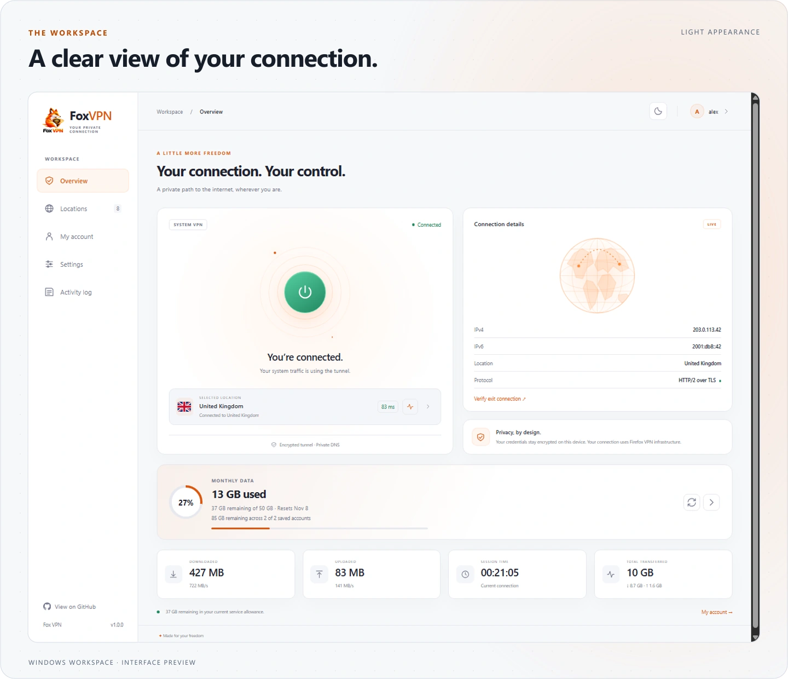
  </picture>
</a>

<details>
<summary><strong>Explore the full interface · dark, light & locations</strong></summary>

**Dark appearance**

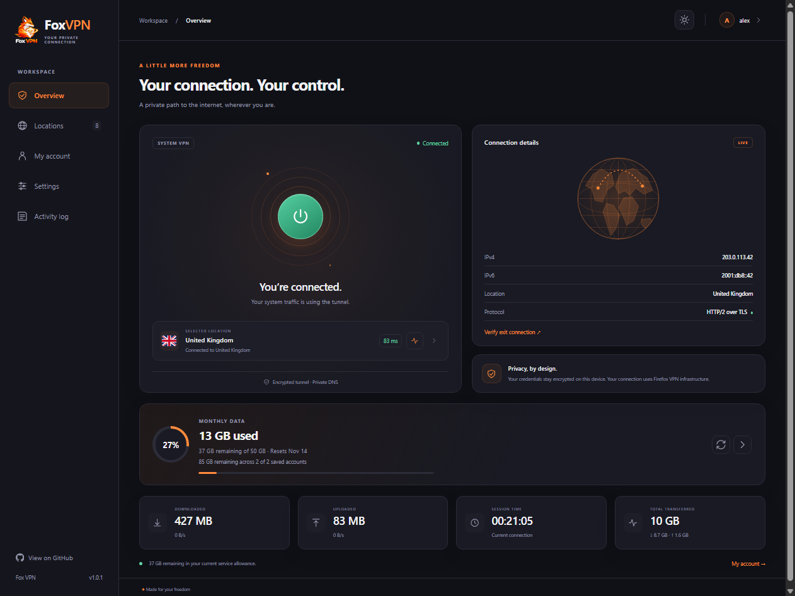

**Light appearance**

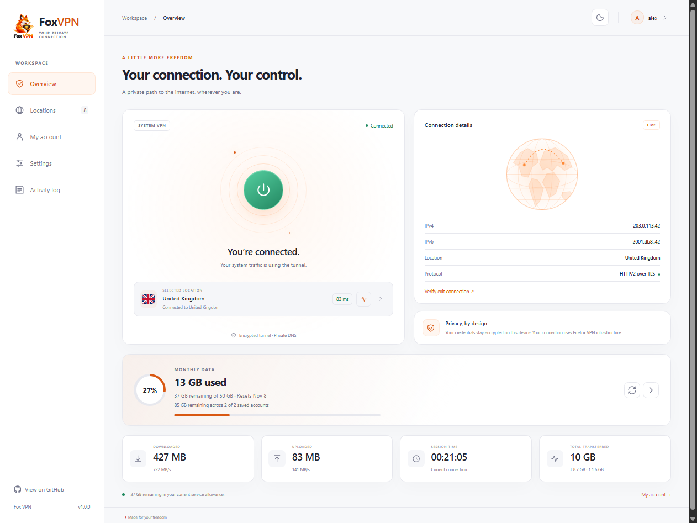

**Saved accounts**

<picture><source media="(prefers-color-scheme: dark)" srcset="docs/screenshots/accounts-dark.png">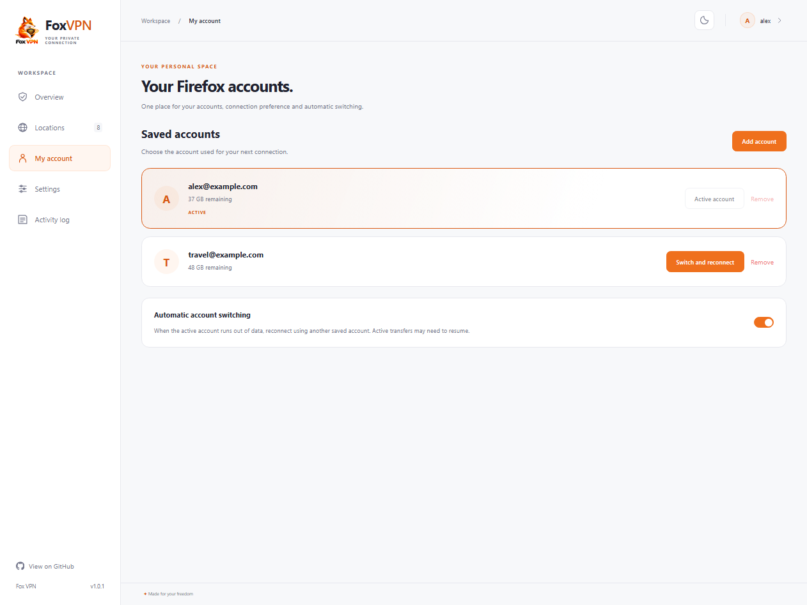</picture>

**Locations**

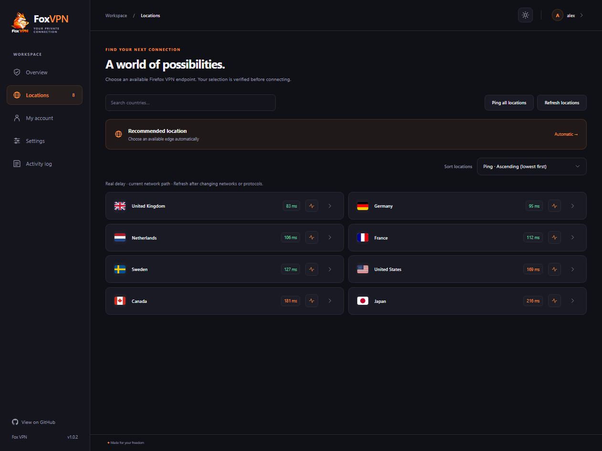

</details>

<sub>Images show the current desktop interface with sample accounts, addresses, usage and latency readings. The compact workspace image is a crop of the desktop preview.</sub>

<a name="traffic-on-your-terms"></a>

## 🔀 Traffic on your terms

Decide which applications use the VPN. Split tunneling offers two routing modes, with a searchable app picker and application icons.

<picture>
  <source media="(prefers-color-scheme: dark) and (max-width: 600px)" srcset="docs/readme/routing-dark-mobile.svg">
  <source media="(max-width: 600px)" srcset="docs/readme/routing-light-mobile.svg">
  <source media="(prefers-color-scheme: dark)" srcset="docs/readme/routing-dark.svg">
  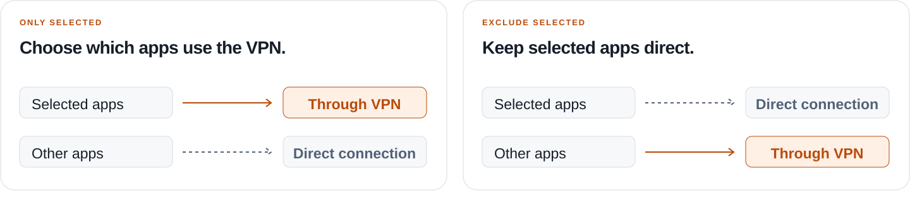
</picture>

Desktop routing follows application process names; macOS includes app helper processes. Linux app discovery uses desktop launchers; sandboxed or wrapper-launched apps may require entering their actual process names manually. Android routing follows application packages. Local network traffic bypasses the tunnel. See [network support](#network-support) for protocol coverage.

### More ways to stay in control

| Find your connection | Make it your own |
| :--- | :--- |
| **🌍 Location choice** - use a recommended endpoint or choose a country manually. | **💾 Saved preferences** - settings, downloaded locations and your preferred location order persist between sessions. |
| **⚡ Latency checks** - measure an HTTPS response through the authenticated VPN tunnel for one location or all locations; sort by real delay or name. | **⚙️ Connection options** - use system VPN or a local SOCKS5 proxy, with HTTP / SOCKS5 upstream support. |
| **📊 At-a-glance activity** - view connection statistics and export diagnostic logs. | **🔐 Local credential protection** - encrypted session storage, configurable DNS and Firefox account email verification and authenticator codes. |

**Android:** Connect or disconnect from Quick Settings, with an active-state tile and persistent notification controls. **Desktop:** Keep Fox VPN available in the system tray when its window is closed.

<a name="get-connected"></a>

## 🚀 Get connected

### 1. Install for your device

<details open>
<summary><strong>Windows</strong></summary>

Run the installer, or extract the **complete** portable ZIP and launch **Fox VPN.exe**. Approve the administrator request for system VPN.

</details>

<details>
<summary><strong>macOS</strong></summary>

Open the DMG and drag **Fox VPN** into **Applications**, or extract the complete app bundle from the ZIP. If Gatekeeper blocks first launch, verify the download and approve it in **System Settings → Privacy & Security → Open Anyway**. System VPN requests administrator authorization when connecting.

</details>

<details>
<summary><strong>Android</strong></summary>

Install the APK and allow installation from your browser or file manager when prompted. Approve the system VPN request on your first connection. Allow notifications to keep connection controls visible.

After signing in and approving the first VPN connection, edit your Quick Settings panel and add **Fox VPN**. Tap the tile to connect or disconnect; its highlighted state indicates an active connection.

</details>

<details>
<summary><strong>Linux</strong></summary>

Choose **DEB** for Debian/Ubuntu or **RPM** for Fedora and compatible distributions. For a standalone package, make the **AppImage** executable and launch it. AppImage may require your distribution's FUSE compatibility package. Use a current desktop with a Secret Service keyring, polkit and a working authorization agent. Approve the polkit request when connecting; the interface itself runs without root access.

</details>

### 2. Sign in, choose a location and connect

If you do not have a Firefox account, [create one](https://accounts.firefox.com/signup) before continuing.

1. Open **My account** and sign in with your Firefox account.
2. Enter the email verification or authenticator code if requested.
3. Choose a location and press the connect button.

Add additional accounts in **My account** and use **Use account** to choose one. Keep **Automatic switching** enabled to move to another saved account when the active account has no data remaining. Allowances are checked separately; saving accounts does not combine them into one subscription.

Press the connect button again to disconnect. On desktop, use **Quit** from the tray to exit the app completely. On Android, the connection stays active in the background.

<details>
<summary><strong>Connect an application through the local proxy</strong></summary>

Enable **Proxy-only mode** in Settings. Configure your application to use `socks5h://127.0.0.1:1080`, or your chosen port. Only applications configured to use this proxy are covered; system routes stay unchanged.

Keep the default loopback binding unless you intend to share the proxy on a trusted network. Binding to all interfaces exposes an unauthenticated proxy to that network.

</details>

<a name="network-support"></a>

## 🌐 Network support

Fox VPN is an independent client built on Mozilla's Firefox VPN infrastructure, with connections carried by Fastly edge servers. Account eligibility, regional availability and data allowances are determined by the service.

| Supported | Boundaries to know |
| :--- | :--- |
| TCP traffic and DNS through the tunnel | General application UDP, including browser QUIC and games, is unsupported. |
| HTTP/2 over TLS or HTTP/3 over QUIC between Fox VPN and the edge | HTTP/3 requires working outbound UDP. Automatic uses HTTP/2 when HTTP/3 cannot be established. |
| Configurable tunneled DNS and upstream proxies | Local network traffic and apps routed directly bypass the tunnel. |
| App-based routing and proxy-only connections | A persistent kill switch is not available. |

For device coverage, automated checks and remaining manual tests, read the [verification record](VALIDATION.md).

<a name="built-in-the-open"></a>

## 🛠️ Built in the open

Fox VPN is licensed under the **[GNU General Public License, version 3 or later](LICENSE)** across Windows, macOS, Linux and Android. See the [copyright notice](COPYRIGHT). Independent dependencies retain their original licenses and notices.

| For developers | For contributors |
| :--- | :--- |
| [Build from source](BUILDING.md) - platform prerequisites and build instructions. | [Report a problem](https://github.com/erfan-tahvilian/FoxVPN/issues) - include your OS, architecture and steps to reproduce. |
| [Verification record](VALIDATION.md) - test coverage and current validation limits. | [Explore the source](https://github.com/erfan-tahvilian/FoxVPN) - review the implementation and contribute improvements. |
| [Changelog](CHANGELOG.md) - release history. | [Release notes](RELEASE_NOTES.md) - installation and release information. |

Remove account details, tokens, IP addresses and other sensitive information before sharing diagnostic logs.

<details>
<summary><strong>Third-party software & corresponding source</strong></summary>

- **sing-box** - GPL-3.0-or-later with its upstream naming condition. The exact corresponding source is included as [sing-box-1.12.0-source.tar.gz](https://github.com/erfan-tahvilian/FoxVPN/releases/download/v1.0.0/sing-box-1.12.0-source.tar.gz). See the [notice](licenses/sing-box-NOTICE.txt) and [source build instructions](https://sing-box.sagernet.org/installation/build-from-source/).
- **Wintun** - redistributed under the license included with Windows packages. See [Wintun](https://www.wintun.net/).
- **Electron, Chromium, Node.js and npm dependencies** - notices are included in desktop distributions. Native Android dependency notices are included in APK assets.
- **HTTP/3 transport** - quic-go, qpack and adapted Firefox VPN client components retain their MIT/BSD notices. See the [transport notice](licenses/http3-NOTICE.txt).
- **flag-icons** - MIT; see the [license notice](licenses/flag-icons-MIT.txt).

</details>

<a name="support-the-project"></a>

## 🧡 Support the project

Help sustain Fox VPN's development and maintenance.

<a href="https://buymeacoffee.com/ErfanTahvilian">
  <picture>
    <source media="(prefers-color-scheme: dark)" srcset="docs/readme/support-dark.svg">
    
  </picture>
</a>

<details>
<summary><strong>Support with cryptocurrency</strong></summary>

**Tron · TRX**

```text
TL8WyZLLGu8UraHAT8dCoeMsnzGpX2oAYn
```

**Binance Coin · BNB · BEP20**

```text
0xeC4F61F21238685cC842bC236D86684e5fc2Bc57
```

**Bitcoin · BTC**

```text
bc1q2y9m8y02fqgsr4c6533duwmqtmrhadc8k8mkt4
```

</details>

<picture>
  <source media="(prefers-color-scheme: dark) and (max-width: 600px)" srcset="docs/readme/signature-dark-mobile.svg">
  <source media="(max-width: 600px)" srcset="docs/readme/signature-light-mobile.svg">
  <source media="(prefers-color-scheme: dark)" srcset="docs/readme/signature-dark.svg">
  
</picture>
